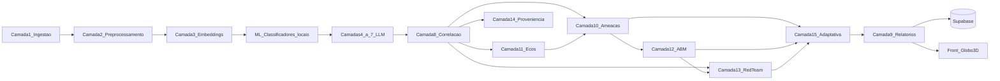

# Arquitetura do Motor

## Visão geral

O motor executa um pipeline batch diário que transforma documentos brutos em um índice escatológico consolidado, persistido no Supabase.



## Motores hierárquicos

| Nível | Frequência | Entrada | Saída |
|-------|------------|---------|-------|
| **Nível 1** | Diário | Textos brutos (24h) | `resultados_escatologicos` |
| **Nível 2** | Semanal → anual | Delta JSON agregado (Motor 1) | `snapshots_periodo` (`weekly`, `monthly`, `quarterly`, `semiannual`, `annual`) |
| **Nível 3** | Trimestral/semestral/anual | Snapshots Nível 2 + RAG teológico (Camada 3) + LLM hermenêutico | `snapshots_periodo` (`*_hybrid`) |

### Janelas temporais (doc)

| Janela | Papel | Motor |
|--------|-------|-------|
| Semanal | Tática — filtro de ruído | Nível 2 |
| Mensal | Estratégica — convicção Bayesiana | Nível 2 |
| Trimestral/Semestral | Ciclos — aceleração de transição | Nível 2 + Nível 3 (`quarterly_hybrid`, `semiannual_hybrid`) |
| Anual | Panorama — mapa da transição entre eras | Nível 2 + Nível 3 (`annual_hybrid`) |

CLI:

```bash
python -m motor.cli run-synthesis --window monthly
python -m motor.cli run-hybrid-analysis --window annual
```

## Camadas

### 1 — Ingestão
- RSS (`config/feeds.yaml`) — geopolítica + UFO/disclosure + engano apocalíptico
- GDELT: themes de `feeds.yaml`, corpo/snippet quando URL disponível; fallback sintético só se `ALLOW_GDELT_SYNTHETIC_FALLBACK`
- ACLED: API key opcional; sem credenciais usa seed `config/acled_seed.json`
- OCR de imagens em `OCR_IMAGES_DIR` (opcional)
- Dedup por `content_hash` + dedup semântico por embedding
  (`SEMANTIC_DEDUP_ENABLED`, `SEMANTIC_DEDUP_THRESHOLD=0.92`; sem modelo de
  embedding, cai no hash)

### 2 — Pré-processamento
- Limpeza HTML, normalização
- Chunking 800 chars, overlap 10%
- Tags de tópico heurísticas

### 3 — Embeddings
- BGE-M3 (`sentence-transformers`) ou fallback hash (log `embedding_hash_fallback_active`)
- Cap configurável `EMBED_CHUNK_LIMIT`
- pgvector para busca semântica
- RAG teológico (`corpus_teologico`) com rerank cross-encoder opcional
  (`RERANKER_*`, `BAAI/bge-reranker-v2-m3`); mesmo reranker alimenta o blend
  profecia↔evento do `FulfillmentTracker` (`FULFILLMENT_CE_WEIGHT`)
- Drift mensal: CLI `run-data-drift` + prompt `embeddings_curation.txt`

### Classificadores locais (`motor/ml/`)

Modelos pequenos que rodam em CPU junto ao motor — sem chave de API,
extra `pip install -e ".[ml]"`. Protótipos zero-shot em
`config/classifier_prototypes.json`.

- **Camada 3.5 — Gate de relevância** (`relevance.py`): ordena chunks por
  relevância escatológica (BGE-M3 zero-shot / fallback lexical) antes da
  extração — substitui o `chunks[:10]` cego; audit `camada_3_gate`
- **Shadow classifier** (`event_classifier.py`): prediz evento/região/
  energia/dimensão e compara com a saída do LLM sem sobrescrevê-la —
  divergências logadas em `camada_4_shadow` (`EVENT_SHADOW_ENABLED`)
- **Destilação** (`distill.py`): exporta dataset de extrações
  (`export-extraction-dataset`) e treina bundle sklearn sobre embeddings BGE
  (`train-event-classifier`). Com `EXTRACTION_MODE=classifier_first`, o modelo
  local responde primeiro e o LLM só entra em baixa confiança
  (`CLASSIFIER_CONFIDENCE_MIN`) ou falha de schema

### 4–7 — LLM (Groq + fallback OpenRouter)
- **4:** extração JSON estruturada (assistida pelo gate 3.5 e pelo shadow
  classifier acima) — formato enforced por `json_schema`
  (`evento_estruturado.schema.json`) na chamada da API
- **5:** linha temporal
- **6:** raciocínio SE/ENTÃO
- **7:** hermenêutica com RAG bíblico

Saída estruturada via configuração da chamada (`json_schema` ou
`json_object`/`format`), não apenas via instrução no prompt — ver
[modelos-locais.md](modelos-locais.md).

### 8 — Correlação
- Bayes (convicção sequencial)
- HMM + Viterbi (fases I–IV)
- Falso líder (incongruência discurso vs estrutura)
- Scores besta mar / terra
- MCDA Top-10
- Proximidade espiritual

### 10 — Ameaças por país
- ~15 países foco (`config/countries_focus.json`)
- Métricas: instabilidade jurídica, controle financeiro, ameaça à liberdade religiosa, intensidade de conflito
- Matriz prescritiva física / financeira / espiritual
- Tabela `ameacas_pais` + payload `ameacas_paises`

### 11 — Ecos históricos
- Análogos seed (`config/historical_echoes_seed.json`)
- Similaridade por keywords + DTW leve + embeddings
- Ajusta urgência das prescrições na L10

### 12 — ABM leve
- Agentes Governo / Finanças / Cidadão / Corporação / Mídia (Python puro)
- 100 runs × 24 meses por país foco
- `fragility_index`, `probabilistic_outcomes`, gatilhos críticos

### 13 — Red team adversarial
- Top-5 países de maior risco
- Bootstrap removendo ~20% dos eventos + síntese LLM (dry-run seguro)
- `resilience_score` e contratese

### 14 — Proveniência (ledger Postgres)
- Cadeia SHA-256 por estágio (`provenance_log`) + Merkle root do dia
- **L14 = Postgres only** — sem publicação Polygon/Ethereum nesta entrega
- UI: botão “Verificar integridade” no drawer do `/globo` (API `provenance/verify`)
- Se `verify_chain` falhar → L15 força `urgency: condicional`

### 15 — Recomendações adaptativas
- Triggers `SE metric > limiar ENTÃO ação em N horas`
- Urgência agora / semana / mês / condicional (se L13 < 0.5 ou falha L14)
- Ordem: selar threats/ABM/adversarial → verify → L15 → relatório → root final

### Joshua Project (BFF + motor)
- **BFF Next:** `GET /api/joshua/sync` (cron + `JOSHUA_SYNC_TOKEN`) e `GET /api/joshua/data`
- Tabelas `joshua_project_data` e `missiological_analysis`
- **Motor:** `joshua_analysis.py` (heurística Expansão/Contração) enriquece L10 por país
- FastAPI: `POST /api/v1/missiological/analyze`, `GET /api/v1/missiological/results`
- UI: bloco Joshua no drawer do país em `/globo`

### 9 — Relatórios
- HTML enriquecido (L10–15, terra ranking, Merkle) via gerador Jinja2
- Rankings, ameaças, proveniência e métricas para dashboard + `/globo`

## Fora de escopo (adiado)
Camadas **16–22** (rede de nós, consenso, tokenomia, DAO, Nostr, mesh Atos), publicação on-chain do Merkle root, lastro BTC e smart contracts SIG — **não implementados** neste núcleo centralizado.

## GNN v1

`PropheticGNN` (`motor/ml/gnn.py`): encoder SAGEConv de 2 camadas via
**PyTorch Geometric** quando o extra `[gnn]` está instalado; fallback
NumPy/NetworkX como proxy de message-passing. Pesos treináveis offline por
link prediction auto-supervisionada (arestas de `grafo_arestas` = positivos)
via `python -m motor.cli train-gnn` → `config/gnn_weights.pt`. Tabelas
`grafo_nos`/`grafo_arestas` persistem a topologia.

## Persistência

Dados de longo prazo ficam **somente no PostgreSQL (Supabase)** — resultados diários, arquivo profético, snapshots, inscritos, ameaças, ABM, adversarial, proveniência, recomendações e cache Joshua. Cold storage em S3/arquivos locais foi desativado. L14 = ledger local no Postgres (Merkle root no DB).
